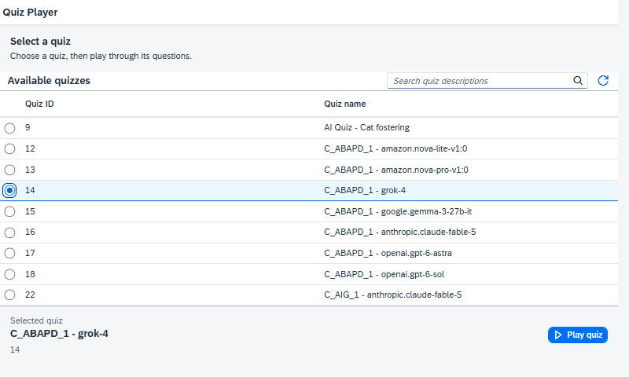
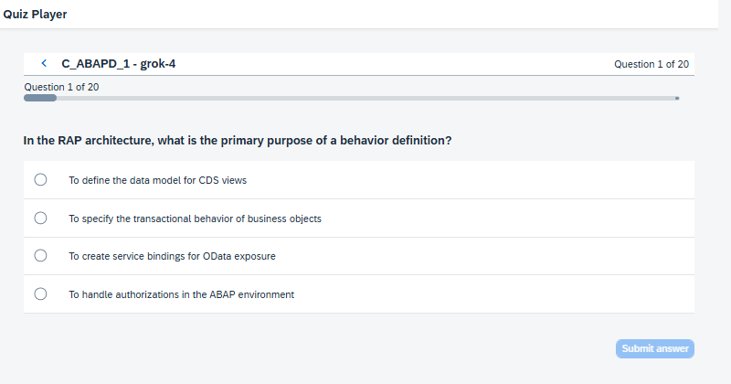
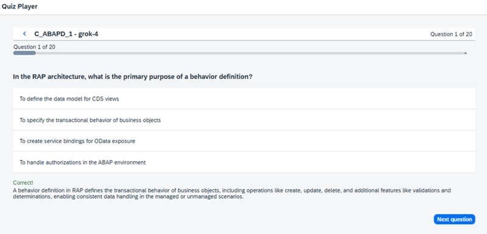
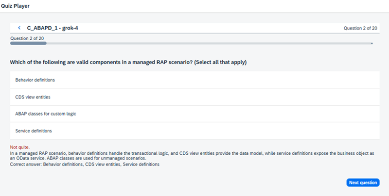
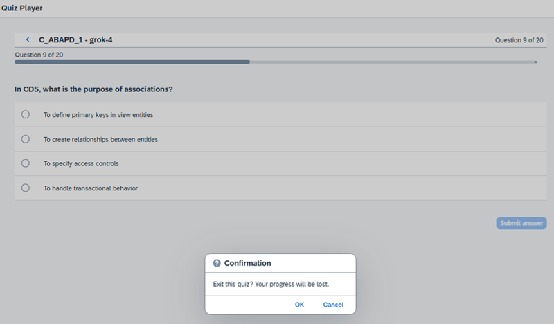
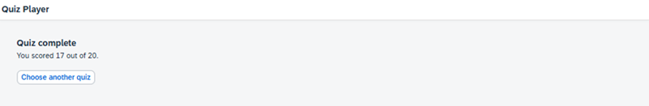
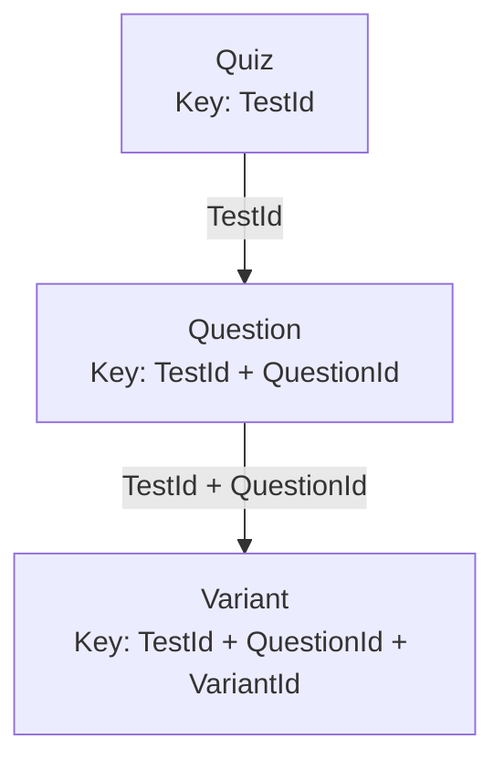

# Quiz Player

## Note

This is my first vibe-coding experience. The objective was to get a
ready backend and vibe-code a frontend app. This project is not intended to
assess the app's quality; the goal is to understand the basics, gauge the
effort involved, and experiment with AI tools.

This file was also generated with minor tweaks.

## Description

A SAPUI5 app for finding and playing quizzes from the SAP OData service. The
quiz list contains only published quizzes users can search
by description, select a quiz, and answer its questions. Supported answer
types include single choice, multiple choice, and free text, with feedback,
explanations, progress, and a final score.

## Screenshots

### Quiz selection

### Playing a quiz

### Correct answer

### Wrong answer

### Trying to exit unfinished quiz

### Finishing quiz

## Environment

- **Backend:** SAP Gateway OData V2 service at
  `/sap/opu/odata/sap/ZNEPT_QZ_UI_QUIZ_R_O2/`.
- **UI framework and runtime:** SAPUI5 1.108.31 using `sap.m` and `sap.ui.core`.
- **Developer tools:** Node.js/npm, SAP Fiori tools, and UI5 CLI.
- **Languages and formats:** JavaScript controllers, XML views, JSON
  configuration, YAML tooling configuration, and `.properties` localization.
- **Development tooling:** `@ui5/cli`, `@sap/ux-ui5-tooling`, and
  `@sap-ux/ui5-middleware-fe-mockserver`.

The development proxy maps `/sap` to the backend configured in
[ui5.yaml](./ui5.yaml). Set its backend URL and SAP client for your system.
Users also need access to the OData service.

## Dependencies

- **Related ABAP CDS project and the backend:** Explore
  [Neptune-Quiz-App-CDS](https://github.com/eborzykh/Neptune-Quiz-App-CDS), a
  data visualization and maintenance layer for Neptune Quiz App, created to
  test and demo ABAP CDS implementations. It documents dependencies on
  [Neptune-Quiz-App-DB](https://github.com/eborzykh/Neptune-Quiz-App-DB) for
  dictionary objects and data provider methods, and
  [Neptune-Quiz-App-SRC](https://github.com/eborzykh/Neptune-Quiz-App-SRC) for
  quiz sources.

## Data structure

The OData service exposes these related entities:

The player loads variant rows by the selected quiz key and groups them by the
question key. Each variant row represents one answer option.

## Run locally

1. Install dependencies with `npm install`.
2. Configure the SAP backend URL and client in [ui5.yaml](./ui5.yaml).
3. Start the Fiori preview with `npm start`.

Use `npm run start-noflp` to open the app directly, or `npm run build` to
create a production build in `dist/`.
